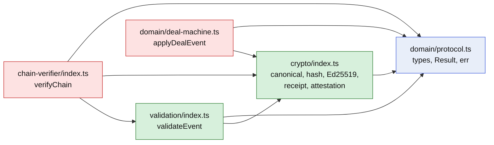
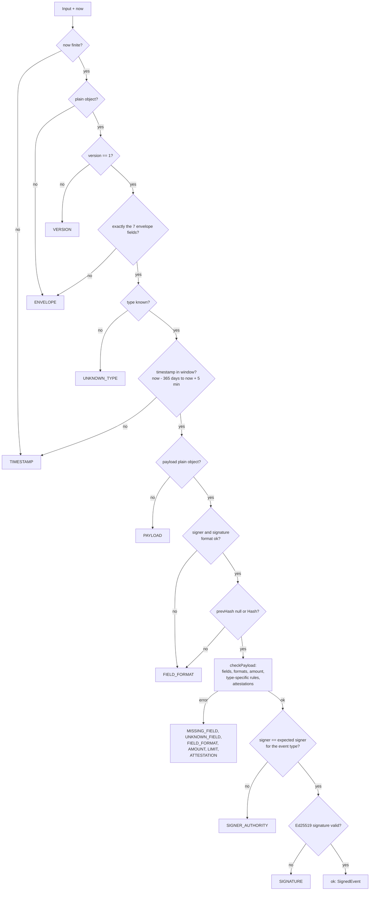
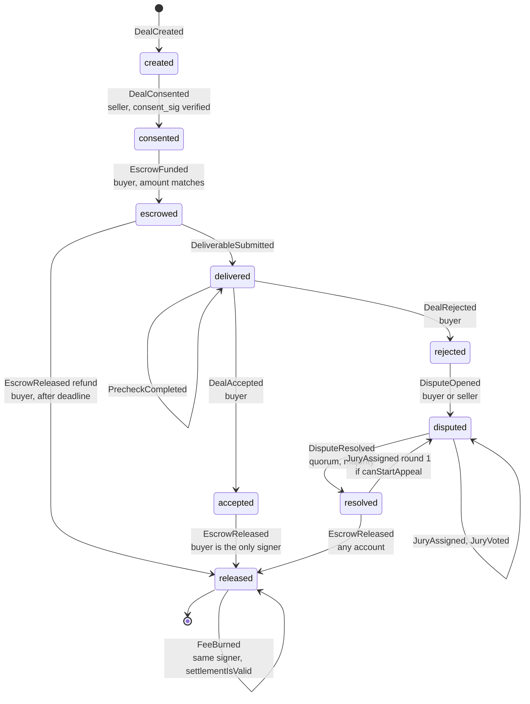
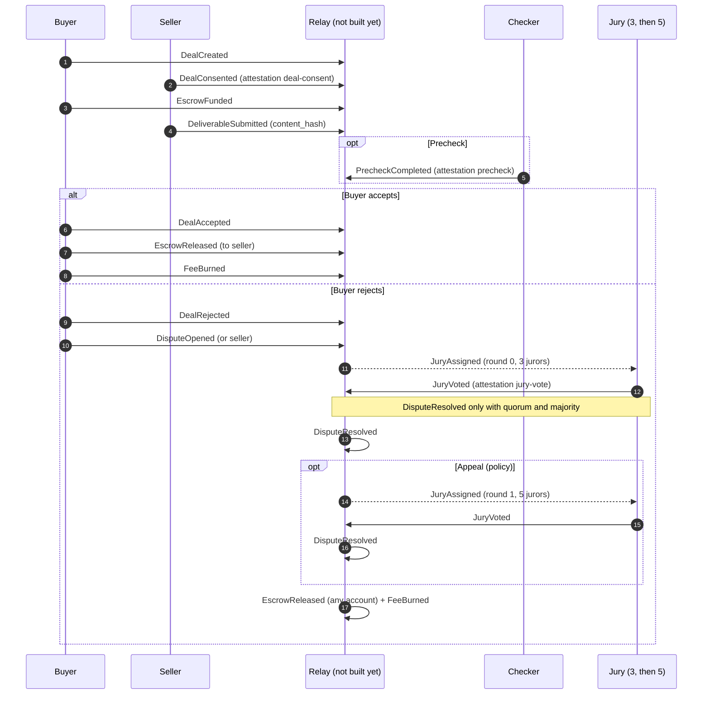
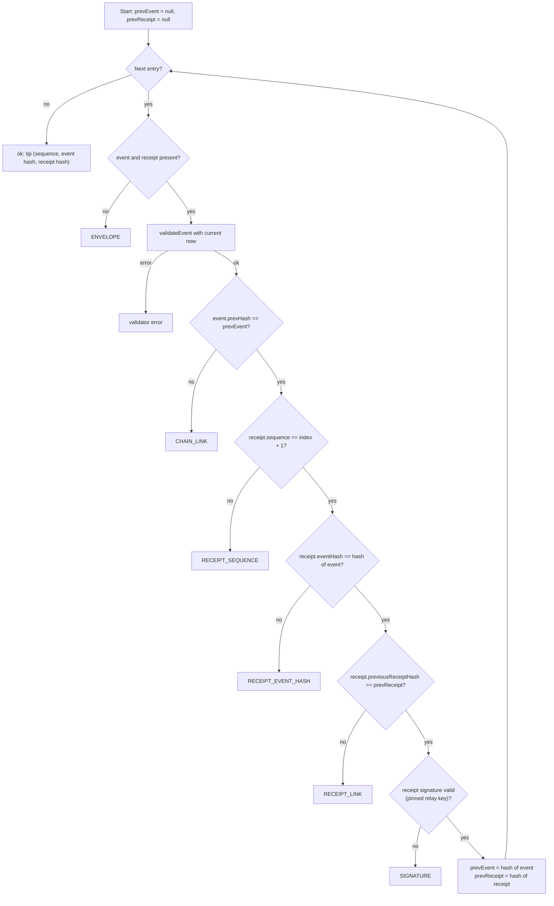
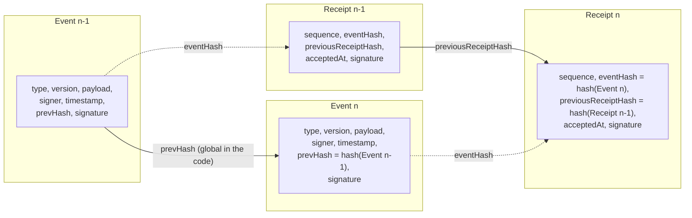
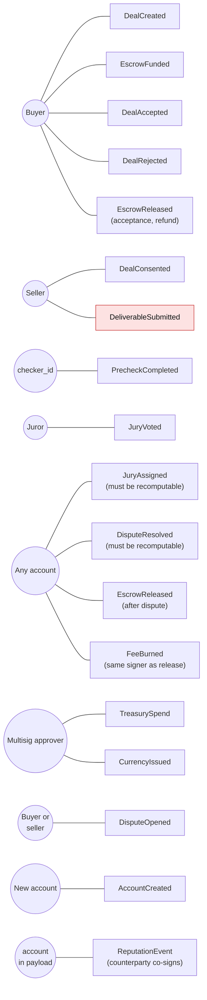
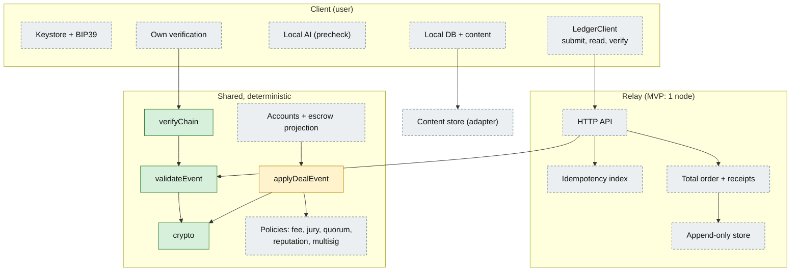

# Skill Exchange Ledger – Diagrams (current code and Core Schema v1)

## 1. Packages and dependencies

Green: has tests. Red: no tests. Blue: types only.

## 2. Validation pipeline (`validateEvent`)

## 3. Deal state machine (`deal-machine.ts`)

Note: `released` is a final state even without `FeeBurned`. The machine does not enforce the fee.

## 4. Deal flow (sequence)

The relay does not exist yet. In the code, the order is only enforced as a projection through `applyDealEvent`.

## 5. Chain verification (`verifyChain`)

Caution: `validateEvent` applies the 365-day window against `now`. Old chains fail verification after one year.

## 6. Data structure: events, receipts, linking

## 7. Signatures and hashes

```mermaid
flowchart TD
  subgraph SIGN["Sign an event"]
    core["Event without signature"] --> can1["canonical JSON<br/>(sorted keys, only strings,<br/>safe integers, booleans, null)"]
    can1 --> utf1["UTF-8 bytes"]
    utf1 --> sig1["Ed25519 signature<br/>(base64, 64 bytes)"]
  end
  subgraph HASH["Event hash"]
    full["Event with signature"] --> can2["canonical JSON"] --> sha1["SHA-256 (hex)"]
  end
  subgraph ATT["Attestation"]
    body["Body"] --> can3["canonical JSON"]
    pre["Prefix skillx/v1/&lt;kind&gt;\\n"] --> cat["prefix + canonical body"]
    can3 --> cat --> sig2["Ed25519 signature"]
  end
  subgraph CONT["Content hash"]
    raw["Raw bytes of the deliverable"] --> sha2["SHA-256 (hex)"]
  end
```

## 8. Who may sign which event

Red: the schema requires the seller as signer, but the code does not check this (neither the validator nor the state machine).

## 9. Target architecture and implementation status

Green: implemented. Yellow: partial (policies injected, fee not enforced). Grey dashed: not built yet.
