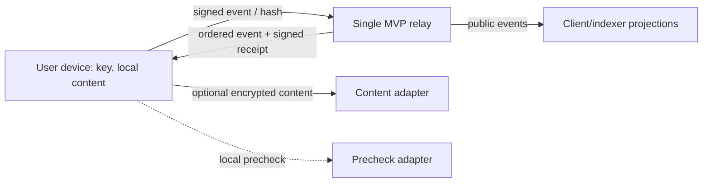

# Threat model and current limits

## Assets and boundaries

Assets: user private keys and recovery material, local deliverables and dispute evidence, event ordering, account balances, and jury outcomes. The relay sees pseudonymous public keys, event payloads, timestamps, and hashes. It must not receive private keys or deliverable bytes.

## Risks

| ID | Threat | Status | Current control / required work |
| --- | --- | --- | --- |
| R-01 | Malicious relay alters or reorders events | Partly addressed | Event signatures and a client-side event/receipt chain verifier exist; relay integration and durable ordering are not implemented |
| R-02 | Replay or duplicate submission | Open | Durable idempotency index and global previous-hash compare-and-append are not implemented |
| R-03 | Double spend or inconsistent escrow | Open | Needs atomic ordered append plus complete accounting projection |
| R-04 | Sybil farming and collusion rings | Partly addressed by design | Counterparty graph, real fees, activity definition, and decay are not implemented |
| R-05 | Jury capture or manipulated assignment | Open | Assignment policy, eligible snapshot, stake, quorum, and reproducible selection remain unresolved |
| R-06 | Forged or cross-context attestations | Partly addressed | Domain-separated Ed25519 helper and structural checks exist; relay integration and full policy checks remain |
| R-07 | Treasury approval replay or substitution | Open | Source schema truncates treasury action-hash preimage; approval verification must wait for a complete frozen definition |
| R-08 | Resource exhaustion through large or malformed requests | Open | No HTTP server, body limits, rate limits, or load testing exist |
| R-09 | Local AI manipulation or false precheck | Accepted design risk | AI is only a prefilter; deterministic checks and counterparty review are planned |
| R-10 | Metadata correlation | Accepted design risk | Pseudonymity does not hide keys, timing, graph relationships, or event amounts |
| R-11 | Key theft or loss | Open | Private-key local storage and recovery workflow are not implemented |
| R-12 | Deliverable disappears before dispute | Open | Content pinning and evidence-retention policy are unresolved |
| R-13 | Legal or moderation failure | Open | No cash-out; legal review and moderation process are prerequisites to public launch |

## Release boundary

The current code is a development foundation, not a safe exchange. Do not issue spendable balances, run a public relay, or use the deal projection as an adjudicator until the missing accounting, persistence, policy, client-verification, operational, and red-team work is complete and reviewed. The system is pseudonymous and intended to become federation-ready; the MVP is not anonymous or decentralized.
