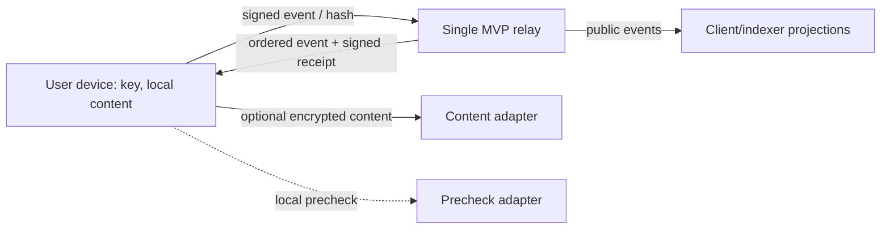

# Threat model and current limits

## Assets and boundaries

Assets: user private keys and recovery material, local deliverables and dispute evidence, event ordering, account balances, and jury outcomes. The relay sees pseudonymous public keys, event payloads, timestamps, and hashes. It must not receive private keys or deliverable bytes.

## Risks

| ID | Threat | Status | Current control / required work |
| --- | --- | --- | --- |
| R-01 | Malicious relay alters or reorders events | Addressed for the MVP | Event signatures, signed receipts, a verifying client, signed checkpoints with equivocation proofs and durable append-only stores (checksummed file, Postgres with append-only trigger). A single relay can still withhold events |
| R-02 | Replay or duplicate submission | Addressed | Per-signer prev-hash compare-and-append, idempotent resubmission, `REPLAY`/`DUPLICATE`/`FORK` codes, replay-equals-live state hash test |
| R-03 | Double spend or inconsistent escrow | Addressed | Serialized atomic append, accounting projection with conservation checks and property tests |
| R-04 | Sybil farming and collusion rings | Partly addressed | Invitation-only accounts, real fees, distinct-counterparty rank, reputation decay and a read-only circular-trading listener; findings are not on the ledger |
| R-05 | Jury capture or manipulated assignment | Partly addressed | Pool snapshot before the dispute, future-receipt beacon, deterministic draw, full quorum, replacement stream. No jury stake in the MVP; relay collusion can still bias the beacon |
| R-06 | Forged or cross-context attestations | Partly addressed | Domain-separated Ed25519 helper and structural checks exist; relay integration and full policy checks remain |
| R-07 | Treasury approval replay or substitution | Addressed | Action hash binds all fields, `(action,nonce)` replay keys, 2-of-3 multisig per active policy. The three key holders remain a trust assumption in the beta |
| R-08 | Resource exhaustion through large or malformed requests | Partly addressed | Body size limit, per-key and per-IP rate limits (trusted proxies configurable); no load testing |
| R-09 | Local AI manipulation or false precheck | Accepted design risk | AI is only a prefilter; deterministic checks and counterparty review are planned |
| R-10 | Metadata correlation | Accepted design risk | Pseudonymity does not hide keys, timing, graph relationships, or event amounts |
| R-11 | Key theft or loss | Partly addressed | Encrypted keystore, BIP39 recovery, delayed key rotation with emergency override; no social recovery, no external review |
| R-12 | Deliverable disappears before dispute | Partly addressed | Content must stay available until the end of the appeal window; missing content is left to jury discretion; retention is local |
| R-13 | Legal or moderation failure | Open | No cash-out; legal review and moderation process are prerequisites to public launch |

## Release boundary

The current code is a development foundation, not a safe exchange. Do not issue spendable balances, run a public relay, or use the deal projection as an adjudicator until the external security review, load testing, user interface and legal review are complete. The system is pseudonymous and intended to become federation-ready; the MVP is not anonymous or decentralized.
